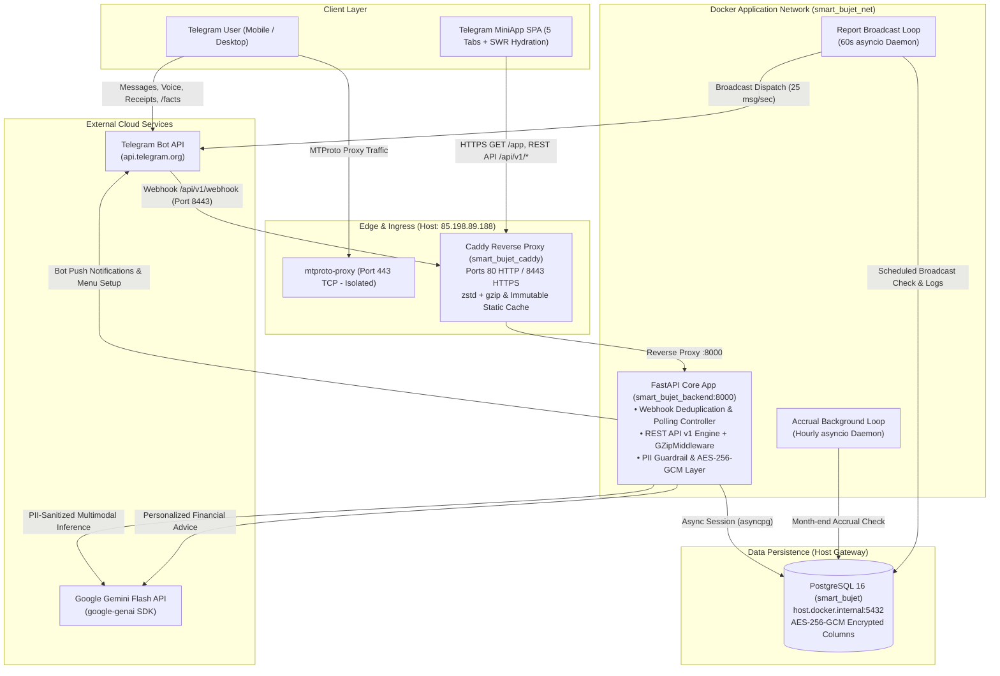
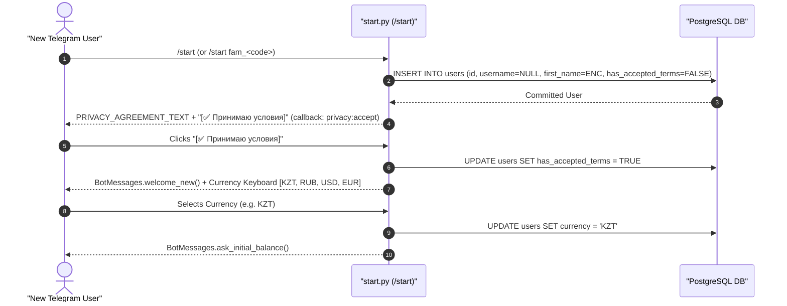
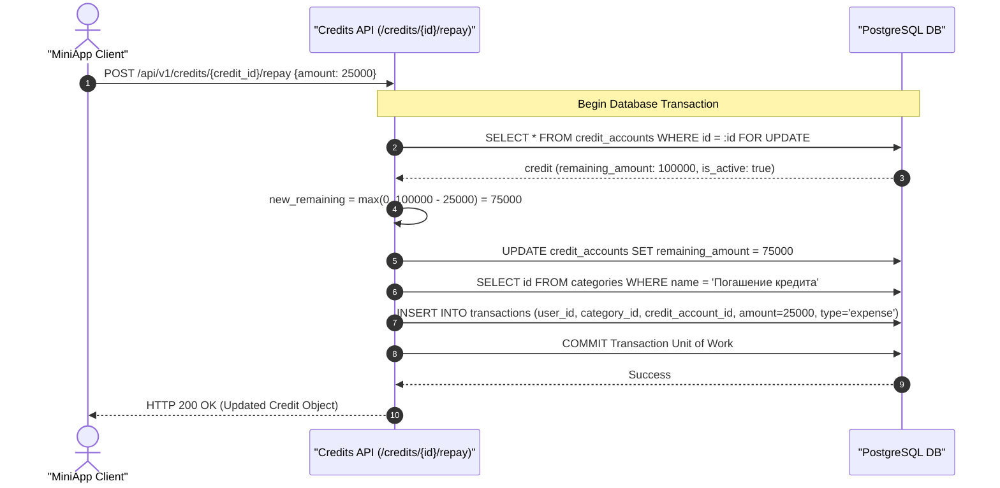
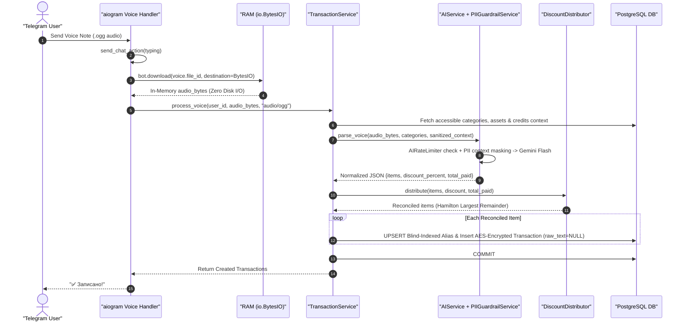
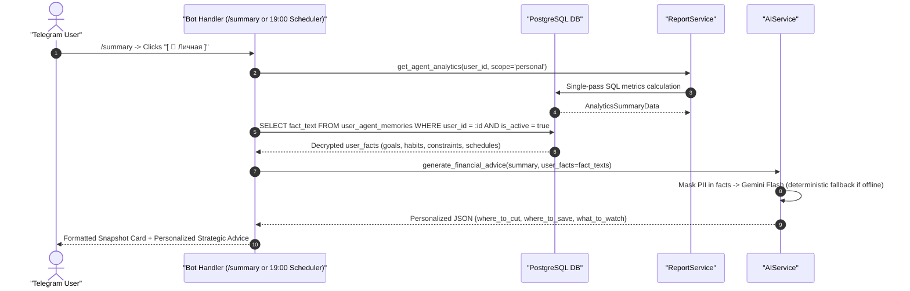
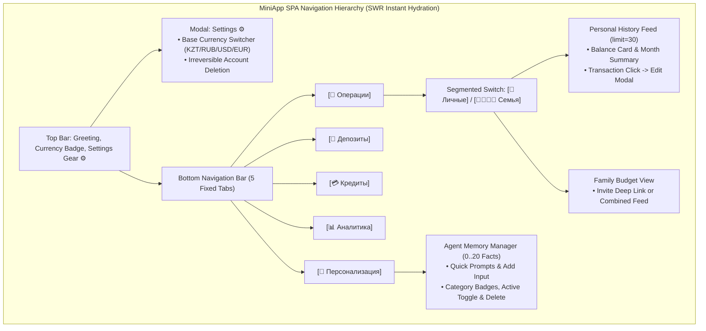

# Smart Bujet — System Architecture & Engineering Blueprint

> **Specification Version**: 2.7.0  
> **Status**: Production Deployed, Argon-Hardened & Personalization-Enabled  
> **Target Audience**: Core Engineering Team, Lead System Analysts, Security Architects, DevOps  
> **Repository**: `https://github.com/AntonioKolosov/smart-bujet`  
> **Server Host**: `85.198.89.188`  
> **Telegram Bot**: `@smartbujetbot`  

---

## 1. Executive Summary & Topology

### 1.1 Overview
**Smart Bujet** is a privacy-first personal and family financial management ecosystem powered by Google Gemini Flash, FastAPI, aiogram 3, PostgreSQL 16, and a fullscreen Telegram MiniApp SPA. The system delivers zero-friction transaction logging through multimodal inputs (natural text, in-memory voice notes, and receipt photographs) combined with:
- **Argon Cryptographic & Privacy Architecture**: AES-256-GCM field-level encryption at rest, HMAC-SHA256 blind indexing, outbound PII Guardrail masking before LLM calls, Admin Blindness (`username=None`), mandatory `/start` User Agreement enforcement (`has_accepted_terms`), and Right to Erasure (`/delete_account` & MiniApp Settings).
- **Long-Term Agent Personalization (`UserAgentMemory`)**: Encrypted personal financial goals, habits, salary schedules, and spending constraints managed via `/facts` and the MiniApp `[🧠 Персонализация]` tab, enriching autonomous financial advice.
- **Dual-Ledger Family Accounting**: Intra-family mirror transfers, intercompany cashflow elimination, personal deposit tracking with automated compound interest accrual, credit and liability management, and an autonomous Agent Analytics & Scoring Engine.

### 1.2 High-Level Architecture Topology



---

## 2. Entity-Relationship Data Model & Schema

The database is built on **PostgreSQL 16** with asynchronous I/O via `asyncpg` and SQLAlchemy 2.0 ORM. All financial amounts utilize fixed-point `Numeric(12, 2)` or `Numeric(14, 2)` to eliminate IEEE 754 floating-point inaccuracies. Sensitive descriptive fields (`first_name`, `item_name`, `raw_text`, `fact_text`, account/credit/group names) use transparent `EncryptedString` / `EncryptedText` TypeDecorators backed by **AES-256-GCM** (`enc:v1:<nonce+ciphertext>`).

### 2.1 Entity Relationship Diagram

```mermaid
erDiagram
    users ||--o{ transactions : "logs"
    users ||--o{ asset_accounts : "owns"
    users ||--o{ credit_accounts : "incurs"
    users ||--o{ user_item_aliases : "creates"
    users ||--o{ user_classification_feedback : "submits"
    users ||--o{ user_agent_memories : "personalizes"
    users ||--o{ scheduled_report_logs : "receives"
    users }o--o| family_groups : "belongs to (family_group_id)"
    users ||--o{ family_groups : "owns as founder (owner_id)"

    family_groups ||--o{ transactions : "consolidates"

    categories ||--o{ transactions : "classifies"
    categories ||--o{ user_item_aliases : "maps to"

    asset_accounts ||--o{ transactions : "tracks capital flow"
    credit_accounts ||--o{ transactions : "tracks repayments"

    transactions ||--o| transactions : "mirrors (related_transaction_id)"

    users {
        bigint id PK "Telegram User ID"
        string username "Always NULL (Admin Blindness)"
        string first_name "AES-256-GCM Encrypted First Name"
        string currency "Base Currency (KZT, RUB, USD, EUR)"
        numeric initial_balance "Starting Liquid Balance Guard"
        uuid family_group_id FK "Active Family Group Reference"
        boolean is_active "Account Status"
        boolean has_accepted_terms "Mandatory User Agreement Flag"
        timestamp created_at "Created Timestamp"
        timestamp updated_at "Updated Timestamp"
    }

    user_agent_memories {
        uuid id PK "Fact UUID"
        bigint user_id FK "Owner User ID (CASCADE)"
        text fact_text "AES-256-GCM Encrypted Personal Fact"
        string category "goal | habit | schedule | constraint | other"
        boolean is_active "Active Flag"
        timestamp created_at "Created Timestamp"
        timestamp updated_at "Updated Timestamp"
    }

    family_groups {
        uuid id PK "Group UUID"
        string name "AES-256-GCM Encrypted Group Name"
        bigint owner_id FK "Founder Telegram ID"
        string invite_code UK "Unique Cryptographic Invite Token"
        timestamp created_at "Created Timestamp"
        timestamp updated_at "Updated Timestamp"
    }

    asset_accounts {
        uuid id PK "Account UUID"
        bigint user_id FK "Account Owner ID"
        string name "AES-256-GCM Encrypted Account Title"
        string type "deposit | currency | savings | investment"
        string currency "Account Currency (KZT, USD, EUR, etc.)"
        numeric balance "Current Account Balance"
        numeric interest_rate "Annual Interest Rate (% APY)"
        boolean is_capitalized "Compound Interest Flag"
        boolean is_active "Active Flag"
        timestamp created_at "Created Timestamp"
        timestamp updated_at "Updated Timestamp"
    }

    credit_accounts {
        uuid id PK "Credit UUID"
        bigint user_id FK "Borrower User ID"
        string name "AES-256-GCM Encrypted Credit Title"
        string bank_name "AES-256-GCM Encrypted Creditor Name"
        numeric original_amount "Initial Principal Liability"
        numeric remaining_amount "Current Outstanding Principal"
        string currency "Credit Currency (KZT, USD, etc.)"
        numeric interest_rate "Annual Interest Rate (% APR)"
        numeric monthly_payment "Scheduled Monthly Payment"
        boolean is_active "Active Debt Flag"
        timestamp closed_at "Date Fully Paid Off"
        timestamp created_at "Created Timestamp"
        timestamp updated_at "Updated Timestamp"
    }

    categories {
        int id PK "Category ID"
        bigint user_id FK "Custom User Category (Null for System)"
        string name "Category Name"
        string type "expense | income | transfer_out | transfer_in"
        boolean is_system "Global System Flag"
        timestamp created_at "Created Timestamp"
        timestamp updated_at "Updated Timestamp"
    }

    user_item_aliases {
        bigint id PK "Alias ID"
        bigint user_id FK "Owner User ID"
        string item_name_normalized "HMAC-SHA256 Blind Index Hash"
        int category_id FK "Target Category ID"
        int usage_count "Frequency Counter"
        timestamp created_at "Created Timestamp"
        timestamp updated_at "Updated Timestamp"
    }

    dynamic_few_shots {
        uuid id PK "Few-Shot UUID"
        string domain_tag "Domain (debt, transfer, food, repair, shopping, misc)"
        string raw_query "Benchmark User Input"
        json expected_payload "Canonical LLM Parsing Output"
        int priority "Retrieval Weight"
        boolean is_active "Active Flag"
        timestamp created_at "Created Timestamp"
        timestamp updated_at "Updated Timestamp"
    }

    user_classification_feedback {
        uuid id PK "Feedback UUID"
        bigint user_id FK "Actor User ID"
        uuid transaction_id FK "Target Transaction ID"
        text original_text "AES-256-GCM Encrypted Query"
        string original_type "Pre-flip Type"
        string corrected_type "Post-flip Type"
        int original_category_id FK "Pre-flip Category ID"
        int corrected_category_id FK "Post-flip Category ID"
        timestamp created_at "Created Timestamp"
        timestamp updated_at "Updated Timestamp"
    }

    scheduled_report_logs {
        uuid id PK "Log UUID"
        bigint user_id FK "Recipient User ID"
        string report_type "weekly | monthly | yearly"
        string period_key "e.g. 2026-W40 | 2026-10 | 2026"
        string status "sent | blocked | failed"
        text error_message "Diagnostic Exception Message"
        timestamp created_at "Created Timestamp"
        timestamp updated_at "Updated Timestamp"
    }

    transactions {
        uuid id PK "Transaction UUID"
        bigint user_id FK "Actor User ID"
        uuid family_group_id FK "Associated Family Group"
        int category_id FK "Target Category"
        numeric amount "Effective Final Amount"
        numeric original_amount "Pre-Discount Base Amount"
        numeric discount_amount "Allocated Discount"
        string type "expense | income | transfer_out | transfer_in"
        uuid asset_account_id FK "Target Asset Account"
        numeric asset_amount "Amount in Target Asset Currency"
        numeric exchange_rate "FX Conversion Rate"
        uuid related_transaction_id FK "Self-ref Mirror Transaction ID"
        uuid credit_account_id FK "Linked Credit / Loan Account"
        string item_name "AES-256-GCM Encrypted Item Title"
        text raw_text "Minimized (NULL on creation)"
        string source "text | voice | photo | manual"
        timestamp transaction_date "Timestamp of Operation"
        timestamp created_at "Created Timestamp"
        timestamp updated_at "Updated Timestamp"
    }
```



### 2.2 Schema & Indexing Highlights
1. **Composite Ledger Indexes**:
   - `ix_transactions_user_id_tx_date ON transactions (user_id, transaction_date DESC)`
   - `ix_transactions_family_group_id_tx_date ON transactions (family_group_id, transaction_date DESC) WHERE family_group_id IS NOT NULL`
   Paired with single-pass SQL `CASE` aggregation in `TransactionService.get_user_balance()`, cold-start profile & feed queries run in sub-10ms constant time.
2. **AES-256-GCM Encryption & Blind Indexing**: Descriptive columns are encrypted transparently at the ORM layer; `user_item_aliases.item_name_normalized` uses an HMAC-SHA256 `blind_index` so exact lookups work in `O(1)` without storing plaintext purchase names.
3. **Long-Term Agent Memory (`user_agent_memories`)**: Stores up to 20 encrypted user facts (`goal`, `habit`, `schedule`, `constraint`, `other`) with `ON DELETE CASCADE` tied to `users.id`.
4. **Self-Referencing Transactions (`related_transaction_id`) & Dedicated Credits (`credit_accounts`)**: Enables atomic dual-ledger intra-family transfers and pessimistic row-locked (`with_for_update`) liability repayments.
5. **Scheduled Broadcast Idempotency (`scheduled_report_logs`)**: Enforces strict exactly-once delivery across weekly, monthly, and yearly cycles via `uq_user_report_period (user_id, report_type, period_key)`.

---

## 3. Core Architectural Sequence Diagrams

### 3.1 Mandatory `/start` User Agreement Gate & Zero-PII Onboarding
Illustrates how every new user (both direct `/start` and `/start fam_<invite_code>`) must accept the User Agreement & Privacy Policy before currency and initial balance setup.



### 3.2 Credit Repayment via MiniApp with Pessimistic Locking



### 3.3 Transaction Deletion & Full ACID Ledger Rollback

```mermaid
sequenceDiagram
    autonumber
    actor User as "User (MiniApp)"
    participant API as "Transactions API"
    participant TS as "TransactionService"
    participant DB as "PostgreSQL DB"

    User->>API: DELETE /api/v1/transactions/{tx_id}
    API->>TS: delete_transaction(user_id, tx_id)
    
    rect rgb(255, 245, 245)
        Note over TS,DB: ACID Ledger Rollback
        TS->>DB: SELECT * FROM transactions WHERE id = :id FOR UPDATE
        DB-->>TS: Transaction tx
        
        opt Linked to AssetAccount
            TS->>DB: SELECT * FROM asset_accounts WHERE id = tx.asset_account_id FOR UPDATE
            TS->>DB: Reverse asset balance adjustment (transfer_out / transfer_in / interest)
        end

        opt Linked to CreditAccount
            TS->>DB: SELECT * FROM credit_accounts WHERE id = tx.credit_account_id FOR UPDATE
            TS->>DB: Restore remaining_amount (remaining += tx.amount; is_active = true)
        end

        opt Has Intra-Family Mirror (related_transaction_id)
            TS->>DB: SELECT * FROM transactions WHERE id = tx.related_transaction_id FOR UPDATE
            TS->>DB: UPDATE Primary.related_transaction_id = NULL, Mirror.related_transaction_id = NULL
            TS->>DB: DELETE FROM transactions WHERE id = mirror_tx.id
        end

        TS->>DB: DELETE FROM transactions WHERE id = tx.id
        TS->>DB: COMMIT
    end

    TS-->>API: Success
    API-->>User: HTTP 204 No Content
```

### 3.4 In-Memory Multimodal Voice Processing with PII Guardrails



### 3.5 Personalized Agent Summary & Scheduled Broadcast Engine



---

## 4. Complete REST API Endpoint Catalog (`/api/v1/*`)

All API routes require authentication via header `X-Telegram-Init-Data` validated against the bot token HMAC-SHA256 signature with replay-window enforcement (`auth_date` max age 86,400s), except the Telegram Webhook callback.

### 4.1 Authentication, Currency & Right to Erasure (`/api/v1/auth`)
| Method | Endpoint | Description | Request Body / Params | Response |
| :--- | :--- | :--- | :--- | :--- |
| `POST` | `/api/v1/auth/validate` | Validates raw Telegram `initData` signature | `{"initData": "string"}` | `{"status": "ok", "valid": true, "user": {...}}` |
| `GET` | `/api/v1/auth/me` | Retrieves authenticated user profile & single-pass SQL balance | Header: `X-Telegram-Init-Data` | `UserMeResponse` (Balance, Month Metrics, Currency) |
| `PATCH` | `/api/v1/auth/currency` | Updates user's primary display/accounting currency | `{"currency": "KZT" \| "RUB" \| "USD" \| "EUR"}` | `UserMeResponse` |
| `DELETE`| `/api/v1/auth/me` | Irreversibly deletes user profile and all cascaded records | Header: `X-Telegram-Init-Data` | HTTP 204 No Content |

### 4.2 Transactions (`/api/v1/transactions`)
| Method | Endpoint | Description | Request Body / Params | Response |
| :--- | :--- | :--- | :--- | :--- |
| `GET` | `/api/v1/transactions/` | Paginated transaction history with unified privacy masking | `include_family` (bool), `limit` (int, default 30), `offset` (int) | `List[TransactionRead]` |
| `POST` | `/api/v1/transactions/` | Creates a manual transaction with business validations | `TransactionCreate` payload (`amount > 0`, `category_id`) | `TransactionRead` |
| `PATCH`| `/api/v1/transactions/{id}` | Edits transaction amount, category, or title with FX & ledger sync | `TransactionUpdate` payload | `TransactionRead` |
| `DELETE`| `/api/v1/transactions/{id}`| Deletes transaction with full ACID ledger rollback | Path: `id` (UUID) | HTTP 204 No Content |

### 4.3 Agent Personalization & Memory (`/api/v1/facts`)
| Method | Endpoint | Description | Request Body / Params | Response |
| :--- | :--- | :--- | :--- | :--- |
| `GET` | `/api/v1/facts/` | Lists user's encrypted personal facts & total counter (max 20) | Header: `X-Telegram-Init-Data` | `FactListResponse` (`items`, `total`) |
| `POST` | `/api/v1/facts/` | Classifies (`goal`, `habit`, `schedule`, `constraint`, `other`) and stores fact | `FactCreate` (`fact_text` 2–300 chars) | `FactRead` (HTTP 201) |
| `PATCH`| `/api/v1/facts/{id}` | Updates fact text, category, or `is_active` toggle | `FactUpdate` payload | `FactRead` |
| `DELETE`| `/api/v1/facts/{id}` | Permanently deletes a personal fact | Path: `id` (UUID) | HTTP 204 No Content |

### 4.4 Credits & Liabilities (`/api/v1/credits`)
| Method | Endpoint | Description | Request Body / Params | Response |
| :--- | :--- | :--- | :--- | :--- |
| `GET` | `/api/v1/credits/` | Lists current user's active/all personal credit accounts | `active_only` (bool, default false) | `List[CreditAccountRead]` |
| `GET` | `/api/v1/credits/summary` | Total liabilities, monthly commitments, and debt breakdown | None | `CreditSummaryResponse` |
| `POST` | `/api/v1/credits/` | Creates a new personal loan/credit liability | `CreditAccountCreate` payload | `CreditAccountRead` |
| `POST` | `/api/v1/credits/{id}/repay` | Repays debt and atomically records ledger expense | `CreditAccountRepay` (`amount > 0`) | `CreditAccountRead` |
| `DELETE`| `/api/v1/credits/{id}` | Deletes or archives a credit account | Path: `id` (UUID) | HTTP 204 No Content |

### 4.5 Analytics (`/api/v1/analytics`)
| Method | Endpoint | Description | Request Body / Params | Response |
| :--- | :--- | :--- | :--- | :--- |
| `GET` | `/api/v1/analytics/report` | Financial summary and category totals for period | `period` (`week`, `month`, `year`), `include_family` (bool) | `ReportResponse` |
| `GET` | `/api/v1/analytics/categories` | Calendar-month category spending breakdown with UI metadata | `family` (bool), `period` (`month`, `year`) | `CategoryAnalyticsResponse` |
| `GET` | `/api/v1/analytics/monthly` | 6-month historical spending and income dynamics | `family` (bool), `months` (int, 1–24) | `MonthlyAnalyticsResponse` |

### 4.6 Asset Accounts & Deposits (`/api/v1/assets`)
| Method | Endpoint | Description | Request Body / Params | Response |
| :--- | :--- | :--- | :--- | :--- |
| `GET` | `/api/v1/assets/` | Lists user's strictly personal active asset accounts | None | `List[AssetAccount]` |
| `GET` | `/api/v1/assets/summary` | Net Worth breakdown (liquid vs locked assets in base currency) | None | `PortfolioSummary` |
| `POST` | `/api/v1/assets/` | Creates a new deposit, savings, or foreign currency account | `CreateAssetRequest` payload | `{"status": "ok", "asset": {...}}` |
| `PATCH`| `/api/v1/assets/{id}` | Edits deposit/currency account parameters | `UpdateAssetRequest` payload | `{"status": "ok", "asset": {...}}` |
| `DELETE`| `/api/v1/assets/{id}` | Liquidates or deletes an asset account safely | Path: `id` (UUID) | HTTP 204 No Content |
| `POST` | `/api/v1/assets/{id}/deposit` | Deposits funds from liquid balance into asset account | `{"amount": float, "note": str}` | `{"status": "ok", "balance": float}` |
| `POST` | `/api/v1/assets/{id}/withdraw` | Withdraws funds from asset account back to liquid balance | `{"amount": float, "note": str}` | `{"status": "ok", "balance": float}` |
| `POST` | `/api/v1/assets/accrue-interest` | Triggers manual month-end interest calculation | None | `{"status": "ok", "accrued_count": int}` |

### 4.7 Family Group Management (`/api/v1/family`)
| Method | Endpoint | Description | Request Body / Params | Response |
| :--- | :--- | :--- | :--- | :--- |
| `GET` | `/api/v1/family/summary` | Consolidated family balances with intercompany elimination | None | `FamilySummaryResponse` |
| `GET` | `/api/v1/family/transactions` | Joint feed of family transactions with privacy masking | `limit` (int, default 60), `offset` (int) | `List[FamilyTransactionItem]` |
| `POST` | `/api/v1/family/join` | Joins a family group via invite code | `{"invite_code": "string"}` | `{"success": true, "group_name": "string"}` |
| `POST` | `/api/v1/family/leave` | Leaves current family group and notifies partner | None | `{"success": true}` |

### 4.8 Categories (`/api/v1/categories`) & Webhook (`/api/v1/webhook`)
| Method | Endpoint | Description | Request Body / Params | Response |
| :--- | :--- | :--- | :--- | :--- |
| `GET` | `/api/v1/categories/` | Lists system and user categories | `type` (`income` \| `expense` \| `transfer_out` \| `transfer_in`) | `List[CategoryRead]` |
| `POST` | `/api/v1/categories/` | Creates a custom user category | `CategoryCreate` payload | `CategoryRead` |
| `POST` | `/api/v1/webhook` | Telegram Webhook Ingress (constant-time token check + `update_id` dedup) | Header: `X-Telegram-Bot-Api-Secret-Token` | `{"status": "ok"}` |

---

## 5. Service Layer Specifications & Business Rules

```
src/
├── core/
│   ├── accrual_scheduler.py       # Hourly compound interest accrual loop
│   ├── report_scheduler.py        # 60s trigger loop for scheduled weekly/monthly/yearly reports
│   ├── config.py                  # Typed settings (MINIAPP_DOMAIN, encryption & blind-index keys)
│   ├── database.py                # Async SQLAlchemy engine & session factory
│   └── security.py                # HMAC initData validation, AES-256-GCM TypeDecorators & blind_index
└── services/
    ├── ai_service.py              # Gemini multimodal parsing, AIRateLimiter, fact classifier & AI advisor
    ├── asset_service.py           # Personal assets, FX conversion & monthly compound interest accrual
    ├── category_service.py        # System seeding & custom category taxonomy
    ├── credit_service.py          # Credit lifecycle, debt summary & heuristic resolution
    ├── discount_service.py        # Hamilton Largest Remainder discount distribution
    ├── dynamic_context_service.py # Few-shot retrieval, prompt injection & alias sanitization
    ├── family_service.py          # Family state, onboarding deep links & intercompany elimination
    ├── parser_service.py          # Heuristic regex parsing
    ├── pii_guardrail_service.py   # Outbound regex/NER PII masking & token restoration before LLM calls
    ├── report_service.py          # Donut & Bar chart analytics aggregations & get_agent_analytics
    └── transaction_service.py     # Central orchestrator, single-pass SQL balance, ACID rollback & masking
```

### 5.1 Financial & Security Invariants

1. **Intra-Family Mirror Preservation ($\Delta B_{\text{family}} \equiv 0$)**: Expense transfers to a family partner create linked mirror transactions (`related_transaction_id`), keeping consolidated net family balance invariant.
2. **Intercompany Cashflow Elimination**: Intra-family transfers are excluded from external family revenues and expenditures.
3. **Credit Repayment Atomicity**: Credit repayments atomically decrease outstanding liability and record an equal ledger expense under `with_for_update()`.
4. **Transaction Deletion Balance Conservation**: Deleting any transaction reverses asset balances, restores credit liabilities, or deletes intra-family mirror pairs within a single ACID transaction.
5. **Universal Family Privacy Masking**: Partner deposit operations are masked to generic labels (`"Пополнение депозита"`, `"Снятие с депозита"`, `"Проценты по вкладу"`).
6. **Scheduled Broadcast Idempotency & Precedence**: Broadcasts trigger at 19:00 local time with precedence $\text{Yearly (Dec 31)} \succ \text{Monthly (Last Day)} \succ \text{Weekly (Sunday)}$ and DB-level uniqueness on `(user_id, report_type, period_key)`.
7. **Autonomous Financial Advisory Integrity**: All financial arithmetic runs in PostgreSQL (`ReportService.get_agent_analytics()`); the LLM acts strictly as a natural-language strategist over pre-computed numbers and sanitized user facts, backed by a deterministic fallback.
8. **Media Group Batch Receipt Atomicity**: Multi-photo receipt albums (`media_group_id`) are debounced in-memory, parsed concurrently, and committed atomically.
9. **Argon Cryptographic & Privacy Architecture**:
   - **Encryption at Rest**: Sensitive strings (`first_name`, `item_name`, `fact_text`, account/credit/group titles) are encrypted via **AES-256-GCM** (`DATA_ENCRYPTION_KEY`).
   - **Blind Indexing**: `user_item_aliases.item_name_normalized` stores deterministic **HMAC-SHA256** digests (`BLIND_INDEX_SECRET`).
   - **Outbound PII Guardrails**: `PIIGuardrailService` masks PAN card numbers, 12-digit IINs, phone numbers, `@handles`, and person names before external Gemini API calls.
   - **Admin Blindness & Data Minimization**: `users.username` is always `NULL`; `transactions.raw_text` is `NULL` on creation.
   - **Mandatory Onboarding Consent & Right to Erasure**: `/start` blocks access until `has_accepted_terms = True` (`privacy:accept`), and `/delete_account` / `DELETE /api/v1/auth/me` executes full cascading deletion.
10. **Personalization Memory Isolation**: `user_agent_memories` is strictly scoped to `user_id` (never shared across family members), capped at 20 active facts, and injected only into personal/user-requested advisory prompts.

---

## 6. MiniApp Navigation & Client Performance Architecture



### 6.1 Frontend & Transport Acceleration
- **Edge & App Compression**: Caddy serves `encode zstd gzip` and immutable cache headers (`Cache-Control: public, max-age=31536000, immutable`) on versioned `/static/*` assets (`?v=2.25`), while `/app` HTML enforces `no-cache, no-store, must-revalidate` for instant rollouts. FastAPI adds `GZipMiddleware(minimum_size=1000)` fallback compression.
- **Zero-Spinner SWR Hydration**: `app.js` snapshots `/auth/me`, `/categories/`, and initial `/transactions/?limit=30` into user-scoped `localStorage` (`sb_cache_v2_<uid>`), painting the UI in `< 50 ms` on launch while revalidating silently in the background.

---

## 7. Deployment & DevOps Architecture

### 7.1 Container Topology & Port Isolation

| Container | Image | Host Port | Internal Port | Memory Limit | CPU Limit | Purpose |
| :--- | :--- | :--- | :--- | :--- | :--- | :--- |
| `smart_bujet_caddy` | `caddy:2-alpine` | `80`, `8443` | `80`, `443` | 64 MB | 0.20 | Reverse proxy, TLS termination, `zstd/gzip` & static cache |
| `smart_bujet_backend` | `smart-bujet-backend:latest` | None | `8000` | 240 MB | 0.40 | Production FastAPI + aiogram 3 backend (`smart_bujet` DB) |
| `smart_bujet_backend_dev` | `smart-bujet-dev-backend:latest` | `127.0.0.1:8001` | `8000` | 240 MB | 0.40 | Isolated Dev Staging backend (`smart_bujet_dev` DB) |
| *Host Process* | `nineseconds/mtg:2` | `443` | `443` | - | - | **MTProto Telegram Proxy (Protected)** |
| *Host Process* | `postgres:16` | `5432` | `5432` | - | - | PostgreSQL 16 Database Server |

> [!IMPORTANT]
> **MTProto Port 443 Isolation Guard**: The host runs an active MTProto proxy on standard port `443`. To prevent port collision, `smart_bujet_caddy` is mapped to **`8443:443`** for HTTPS/Webhook traffic and **`80:80`** for HTTP. Port 443 on the host remains completely untouched.

### 7.2 Security & Reliability Hardening Checklist
- [x] **MTProto Isolation**: Host port 443 dedicated to MTProto; Caddy binds to 8443.
- [x] **AES-256-GCM Encryption at Rest**: Transparent encryption on PII & financial item titles (`EncryptedString` / `EncryptedText`).
- [x] **HMAC-SHA256 Blind Indexing**: Privacy-preserving fast-path item alias lookups.
- [x] **Outbound PII Guardrails**: Automatic masking of cards, IINs, phones, and names before Gemini inference.
- [x] **Mandatory User Agreement Gate**: Enforced on `/start` (including family invite deep links) via `users.has_accepted_terms`.
- [x] **Admin Blindness & Right to Erasure**: `username=None`, `raw_text=None`, `/delete_account`, and `DELETE /api/v1/auth/me`.
- [x] **Webhook Validation & Deduplication**: Constant-time `secrets.compare_digest()` + bounded `update_id` replay cache.
- [x] **AI Quota Guard**: Per-user sliding-window `AIRateLimiter` protecting LLM budget from abuse.
- [x] **XSS Mitigation**: Contextual HTML escaping (`escapeHtml`) across all MiniApp & Telegram HTML rendering paths.
- [x] **Pessimistic Locking & Composite Indexes**: `with_for_update()` on balance mutations + `(user_id, transaction_date DESC)` composite indexes.

---

*Architectural Blueprint v2.7.0 approved and certified for Production & GitHub repository documentation.*
